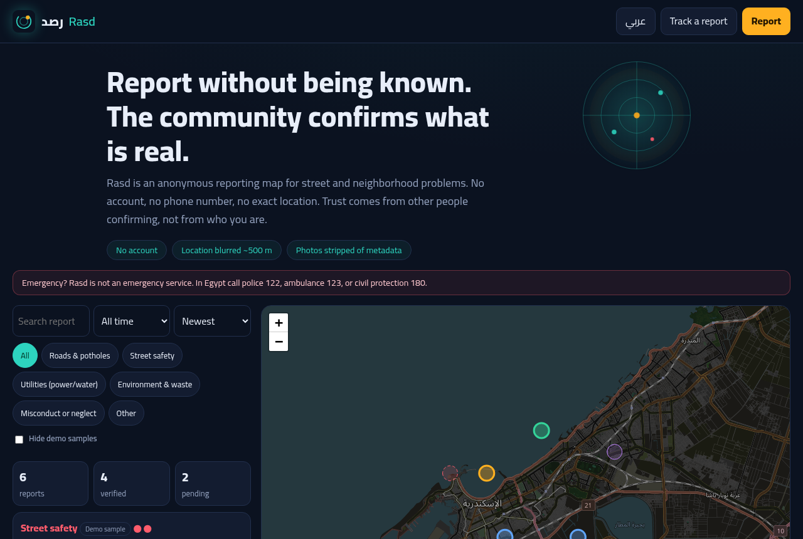
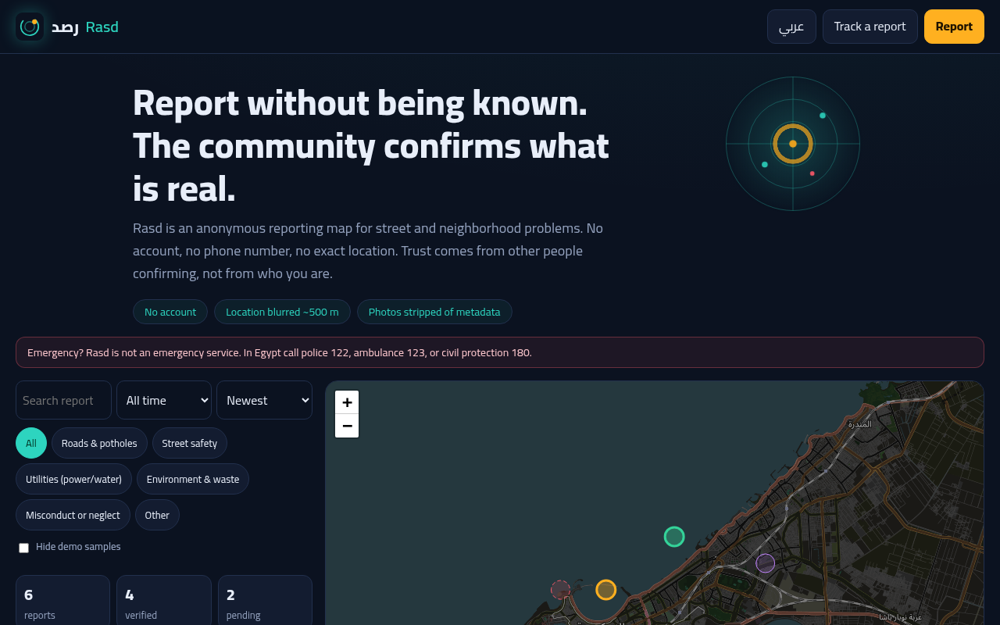
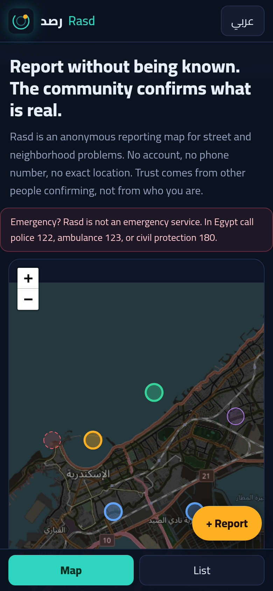
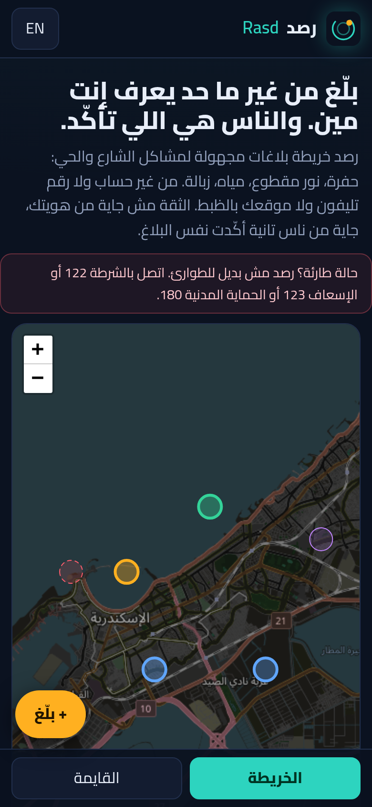
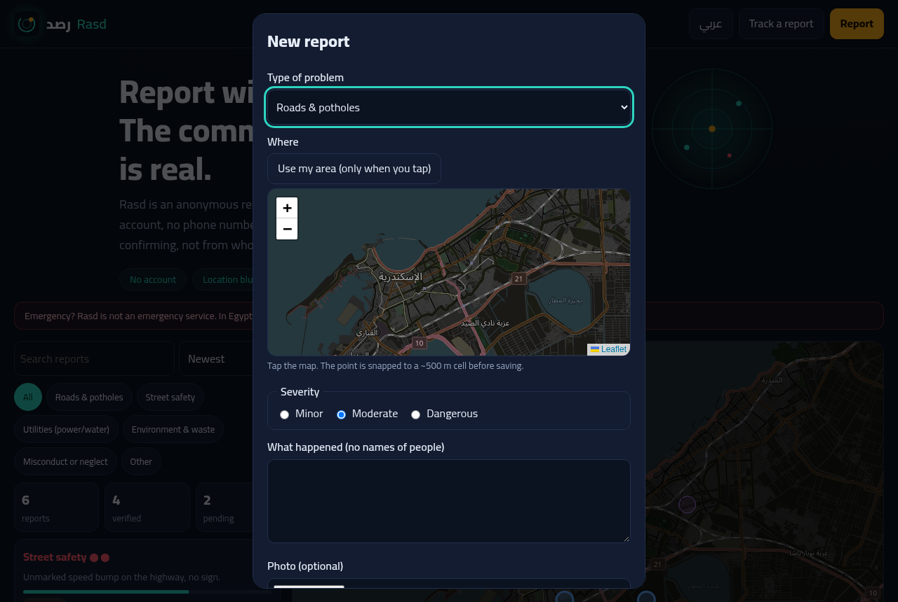

<div align="center">


# Rasd · رصد

**Report street problems anonymously. The community, not your identity, proves they are real.**

[**Live demo**](https://yousefkhames.github.io/rasd/) · Arabic (RTL) first, English included · Installable PWA · MIT



</div>

## Screenshots

Captured from the live site (https://yousefkhames.github.io/rasd/).

<p>
  
  
</p>

## Why

Reporting a pothole, a dead street light, a water cut or contractor neglect should not require handing over your name, phone number or exact home area. But anonymous reports are easy to fake. Rasd explores how to get **trust without identity**: other people confirm or dispute a report, and the app protects the reporter by design.

## Screenshots

| Mobile (Arabic, RTL) | Mobile (English) | Report flow |
|---|---|---|
|  |  |  |

## Features

- **Anonymous by design**: no accounts, emails or phone numbers. The API stores no IPs or user agents.
- **Blurred location**: points snap to a ~500 m grid cell and time to the hour. You can find the area, not the house. The server re-blurs and never trusts the client.
- **Automatic scrub**: phone numbers, emails and 14-digit national IDs are masked in text. Photos are re-encoded in a canvas, which drops EXIF/GPS.
- **Community verification**: `score = 1 + confirmations + photo - 1.5 x disputes`. Verified at 3, disputed when rejections win, "resolved" after 3 "fixed" votes, hidden after 3 abuse flags.
- **Receipt codes**: follow a report with a secret code. Only its SHA-256 hash is stored.
- **Great on phones**: map/list tabs, floating report button, full-screen dialogs, safe-area aware.
- **Accessible**: skip link, ARIA roles and live regions, visible focus, reduced-motion support.
- **Arabic-first**: RTL layout, Egyptian-Arabic copy, localized numerals and relative time through `Intl`.
- **Works offline**: installable PWA with an offline shell.
- **You own your data**: export, import and erase everything on your device.
- **Optional live backend**: point the UI at the included Node API with `?api=https://your-server`.

## Tech stack

Vanilla JavaScript (no framework, no build step), Leaflet + OpenStreetMap tiles, Web Crypto, Service Worker. Backend: zero-dependency Node.js HTTP server. Tests: Node `assert` unit tests, API tests, and a Puppeteer end-to-end suite (desktop and mobile, Arabic and English).

## Run it

```bash
git clone https://github.com/yousefkhames/rasd && cd rasd
python3 -m http.server 8000 --directory web   # open http://localhost:8000
npm start                                     # optional API on :8787
# then open http://localhost:8000/?api=http://localhost:8787
npm test                                      # unit + API tests
npm i && npm run test:e2e                     # browser tests (needs Chrome at /usr/bin/google-chrome)
```

The published demo is served from `docs/` (a copy of `web/`) with GitHub Pages.

## Project layout

```
web/core.js       privacy + verification rules, shared by browser and server
web/app.js        UI, i18n, map, local-first storage, optional API client
server/server.js  zero-dependency REST API (incidents, votes, receipt tracking)
tests/e2e.js      real-browser click-through tests
```

## Honest limits

- The live demo is **local-first**: reports are saved in your browser, and the sample incidents on the map are demo data.
- Anonymous voting can be gamed by one person with many devices. Next steps: proof-of-work per vote, location-gated voting ("I am near this"), moderator review.
- Personal-data masking is pattern based (emails, Egyptian mobile numbers, 14-digit IDs, long digit runs, also in Arabic digits or with spaces and dashes). It will miss names and addresses typed in words.
- Rasd cannot stop false or harmful text. Abuse flags and auto-hide help but do not replace human review.
- It is not an emergency service and does not forward reports to authorities. In Egypt: police 122, ambulance 123, civil protection 180.

## License

MIT, see [LICENSE](LICENSE). Built by [Yousef Khames](https://www.linkedin.com/in/yousef-khames-elasuoty).


## Demo / portfolio project

Static GitHub Pages site. Data stays in your browser. Sample data is fictional and results are not professional, legal, medical or financial advice.

By Yousef Khames · من تطوير يوسف خميس
